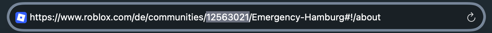

Hier erfährst du Schritt für Schritt, wie du die Roblox-Gruppen API im Personensystem verbindest, Ränge zuweist und den automatischen Rangwechsel konfigurierst.

---

## 1. Gruppe verbinden

Um deine Roblox-Gruppe zu verknüpfen, benötigst du lediglich die Gruppen-ID aus der Web-Adresse.

1. Öffne deine Roblox-Gruppenseite im Browser.
2. Kopiere die **ID aus der URL** (z. B. `1234567` aus `roblox.com/groups/1234567/Name`).
3. Füge die ID in das entsprechende Feld im Bot/Dashboard ein.

---

## 2. Ränge zuweist (Mapping)

Es stehen zwei Optionen zur Verfügung, um Roblox-Ränge den System- bzw. Discord-Rollen zuzuordnen:

- **Smart-Auto-Mapping:** Erkennt passende Rollen (z. B. _Polizei_, _Team_, _Fraktion_) automatisch und nimmt die Zuordnung vor.
- **Manuelle Zuweisung (`Recht ↔ Rolle zuweisen`):** Erlaubt das gezielte, manuelle Festlegen von einzelnen Rechte-Paaren.

<Frame caption="Dashboard-Ansicht der Ausfall- und Mapping-Optionen">
  {/* Hier ein Screenshot der Buttons für Smart-Auto-Mapping und manuelle Zuweisung */}
</Frame>

---

## 3. Automatischer Rangwechsel

Damit Ränge automatisch geändert werden können, musst du **eine der beiden** folgenden Authentifizierungsmethoden einrichten:

### Option A: Open Cloud User API Key (Empfohlen)

<Steps>
  <Step title="Creator Dashboard öffnen">
    Navigiere zu den [Roblox Creator Dashboard Credentials](https://create.roblox.com/dashboard/credentials).
  </Step>
  <Step title="Profil auswählen">
    <Warning>
      **Wichtig:** Wähle oben links dein **persönliches Profil** aus und **nicht** die Gruppe!
    </Warning>
  </Step>
  <Step title="API-Key erstellen">
    Erstelle einen neuen Key mit folgenden Parametern:

    - **Berechtigungen:** `group.membership:read` und `group.membership:write` (zugewiesen an deine Gruppe).
    - **IP-Freigabe:** `0.0.0.0/0`
  </Step>
</Steps>

### Option B: Bot-Account Cookie (Schnelle Einrichtung)

- Trage das `.ROBLOXSECURITY`-Cookie eines **Bot-Accounts** ein, der in deiner Gruppe über ausreichende Rang-Verwaltungsrechte verfügt.
- Diese Methode ist sofort einsatzbereit.

<Warning>
  **Sicherheitshinweis:** Gib dein Cookie niemals an Dritte weiter. Verwendungszweckmäßig sollte hierfür immer ein separater Bot-Account genutzt werden.
</Warning>

---

## 4. Unterstützter 1-Klick Modus

Falls **keine** Authentifizierung (weder API Key noch Cookie) hinterlegt ist, schaltet das System automatisch in den unterstützen manuellen Modus:

- Bei der Annahme eines Antrags generiert der Bot einen **Direktlink zur gefilterten Roblox-Mitgliedersuche**.
- Über diesen Link gelangst du sofort zur entsprechenden Person und kannst den Rang mit einem Klick manuell anpassen.

<Frame caption="Discord-Nachricht des Bots mit dem Direktlink zur gefilterten Mitgliedersuche">
  {/* Hier ein Screenshot der Bot-Nachricht mit dem Link */}
</Frame>
